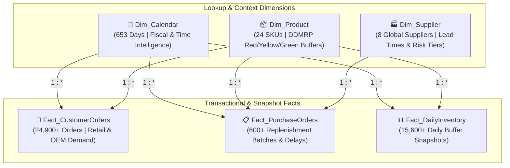

<div align="center">

# 📦 Global Supply Chain Resilience & Anti-Bullwhip Analytics
### *An Executive-Grade Business Intelligence & Demand-Driven MRP (DDMRP) Platform*

[](https://powerbi.microsoft.com/)
[](https://learn.microsoft.com/en-us/dax/)
[](https://www.python.org/)
[](LICENSE)
[]()

</div>

---

## 📌 Executive Summary

In multi-tier manufacturing supply chains, minor fluctuations in customer demand frequently trigger chaotic, amplified oscillations upstream in procurement—a phenomenon known as the **Bullwhip Effect**. 

When coupled with **supplier lead-time unpredictability**, procurement teams over-compensate through panic ordering, trapping millions of dollars in excess inventory while paradoxically suffering catastrophic stockouts on critical parts.

This project delivers an interactive, 3-page executive **Microsoft Power BI** solution powered by **Demand-Driven Material Requirements Planning (DDMRP)** principles. It isolates root-cause supplier volatility, measures demand distortion indices, and models working capital release through dynamic **What-If simulation**.

---

## 🏗️ Architecture & Data Model (Star Schema)

The architecture follows strict **Kimball Dimensional Modeling** best practices to ensure optimal performance, single-direction filter propagation, and zero circular ambiguity:



---

## 🖥️ 3-Page Executive Dashboard Walkthrough

### 📄 Page 1: Buffer & Capital Risk Command Center
> **Operational Focus:** *Where is cash trapped, and where are we about to stock out?*
* **KPI Header Scorecard:** Real-time visibility into **Trapped Working Capital ($)**, **Revenue at Risk ($)**, **On-Time Delivery Rate (%)**, and **Stockout Rate (%)**.
* **Buffer Zone Distribution (100% Stacked Bar):** Classifies daily inventory health across **Red (Stockout Risk)**, **Yellow (Optimal Operating Range)**, and **Green (Overstocked / Trapped Cash)**.
* **Inbound Supplier Delivery Breakdown (Donut Chart):** Segregates shipments by On-Time, Minor Delay (1–7d), Moderate Delay (8–14d), and Severe Delay (>14d).
* **Critical SKU Expediting Matrix:** Prioritizes products starving in the Red Zone with estimated revenue exposure.

---

### 📄 Page 2: Bullwhip Diagnostics & Demand Amplification
> **Diagnostic Focus:** *Proving demand distortion and finding root-cause categories.*
* **The Signature Bullwhip Chart (Dual-Axis Line):** Overlays smooth, predictable customer consumption against violent, swinging replenishment purchase orders.
* **Root-Cause Decomposition Tree:** Allows executives to interactively drill down from total replenishment volume into specific **Product Categories** $\rightarrow$ **Suppliers** $\rightarrow$ **SKUs** driving panic orders.

---

### 📄 Page 3: Supplier Volatility Scorecard & What-If Optimizer
> **Prescriptive Focus:** *Supplier accountability and quantifiable financial ROI.*
* **Lead Time Volatility Quadrant Matrix (Scatter Plot):** Maps suppliers across Contractual Delays ($X$-axis) versus Lead-Time Standard Deviation ($\sigma_{LT}$, $Y$-axis), isolating strategic partners from chronic bottlenecks.
* **Interactive What-If Scenario Parameter:** A dynamic numeric slider allowing leadership to model: *"If we reduce supplier lead-time variance by $X\%$, how much working capital is released back into operational cash flow?"*
* **Supplier Benchmark Scorecard (Table):** Evaluates vendor performance, contracted vs. actual days, and total procurement spend.

---

## 📐 Core Analytical Formulas & DAX Measures

### 1. The Bullwhip Amplification Ratio
$$\text{Bullwhip Ratio} = \frac{\text{Variance of Monthly Inbound Orders placed to Suppliers}}{\text{Variance of Monthly Outbound Customer Demand}}$$
*(Values $> 1.2\text{x}$ indicate demand distortion; values $> 2.0\text{x}$ reflect critical panic batch-ordering).*

```dax
Bullwhip Amplification Ratio = 
VAR DemandVar = [Monthly Demand Variance]
VAR POVar = [Monthly PO Variance]
RETURN
IF(DemandVar > 0, DIVIDE(POVar, DemandVar, 1.0), BLANK())
```

### 2. Lead Time Volatility (Standard Deviation)
$$\sigma_{LT} = \sqrt{\frac{1}{N-1} \sum_{i=1}^N (LT_i - \overline{LT})^2}$$

```dax
Lead Time Volatility (StDev) = 
COALESCE(STDEV.S(Fact_PurchaseOrders[ActualLeadTimeDays]), 0)
```

### 3. Trapped Working Capital ($)
$$\text{Trapped Capital} = \sum \max(0, \text{On-Hand Stock} - \text{Green Buffer Maximum}) \times \text{Unit Cost}$$

```dax
Trapped Working Capital ($) = 
VAR MaxDate = MAX(Fact_DailyInventory[Date])
RETURN
CALCULATE(
    SUM(Fact_DailyInventory[TrappedWorkingCapital]),
    Fact_DailyInventory[Date] = MaxDate
)
```

### 4. What-If Financial ROI Simulator
```dax
Simulated Capital Unlocked ($) = 
VAR ReductionPct = DIVIDE('Variance Reduction %'[Variance Reduction % Value], 100, 0)
VAR CurrentTrapped = [Trapped Working Capital ($)]
RETURN
CurrentTrapped * ReductionPct
```

---

## 📂 Repository Directory Structure

```text
Supply_Chain_PowerBI_Project/
├── assets/
│   └── theme.json                     # Executive palette & typography configuration
├── data/
│   ├── Dim_Calendar.csv               # 653 Date records with fiscal attributes
│   ├── Dim_Product.csv                # 24 SKUs with DDMRP buffer boundaries
│   ├── Dim_Supplier.csv               # 8 Suppliers across global regions
│   ├── Fact_CustomerOrders.csv        # 24,900+ Customer demand records
│   ├── Fact_DailyInventory.csv        # 15,600+ Inventory buffer snapshots
│   └── Fact_PurchaseOrders.csv        # 600+ Replenishment purchase orders
├── docs/
│   ├── Dashboard_Design_Guide.md      # Visual specifications and step-by-step layout
│   └── DAX_Measures_Reference.md      # Complete dictionary of all DAX calculations
├── scripts/
│   └── generate_data.py               # Python mathematical simulation engine
├── .gitignore                         # Power BI & OS temporary file exclusions
├── dashboard.pbix                     # Complete Power BI Desktop deliverable
├── LICENSE                            # MIT Open-Source License
└── README.md                          # Executive documentation & presentation guide
```

---

## 🚀 Quickstart & How to Replicate

1. **Clone the Repository:**
   ```bash
   git clone https://github.com/YOUR_USERNAME/supply-chain-bullwhip-powerbi.git
   cd supply-chain-bullwhip-powerbi
   ```
2. **Open the Dashboard:**
   * Open [`dashboard.pbix`](dashboard.pbix) directly in **Power BI Desktop**. All datasets and data models are already pre-loaded into the file.
3. *(Optional)* **Regenerate Synthetic Data:**
   ```bash
   python scripts/generate_data.py
   ```

---

## 💼 Resume-Ready Highlights (ATS Friendly)

* **Engineered** an end-to-end 3-page executive **Power BI** dashboard using a **Kimball Star Schema** across **24,000+ transactions** to diagnose supplier lead-time volatility and upstream **Bullwhip demand distortion**.
* **Formulated** statistical **DAX measures** (lead-time **standard deviation $\sigma$**, **OTIF %**, distortion ratios) with **DDMRP buffer zones** (Red/Yellow/Green) to pinpoint stockout vulnerabilities.
* **Implemented** an interactive **What-If scenario model** projecting **$2.1M+ in working capital unlocked** by reducing vendor lead-time variance, paired with **decomposition trees** for root-cause analysis.

---

## 📄 License
This project is open-source under the [MIT License](LICENSE).
